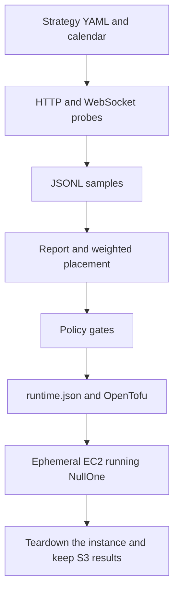

[](https://github.com/theorem-stack/source-latency-profiler-community/actions/workflows/pytest.yml)

# Source Latency Profiler

Source Latency Profiler measures DNS, TCP, TLS, time to first byte, and total time for HTTP and WebSocket calls from the machine running the CLI, then ranks those samples by tail latency, jitter, and failures. It exists to pick where a NullOne-style latency-sensitive bot should run: a scheduled release is only as fast as the path from the host that reads the source to the venue that must hear the reaction, and public APIs sit behind CDNs and anycast, so the region printed on a hostname is the wrong question. Strategy files score candidate locations and can turn a passing placement into an AWS plan that starts NullOne on an ephemeral EC2 host. This repository is measurement and infrastructure code. It does not contain a trading engine.

Version 0.1.0. Python 3.11+. The console script is `latency-profiler` (`profiler.cli:main`). Command examples live in [docs/commands.md](docs/commands.md).

## Related project

[NullOne](https://github.com/theorem-stack/NullOne-community) is a Python bot that trades Kalshi and Polymarket brackets on the EIA weekly natural gas storage report. Paper mode is the default. This profiler measures candidate hosts so that bot can be placed where the source and the venue respond fastest.



## What the code does

**Measure.** `probe` (alias `run`) and `burst` load a YAML target file and open sockets in this process. Each sample records DNS time, resolved addresses, TCP connect, TLS handshake and protocol, status code, time to first byte, download time, total time, redirect chain, selected response headers (`server`, Cloudflare and cache headers), byte count, and the error string when a probe fails. WebSocket targets, when the `ws` extra is installed, record upgrade time and time to the first message. `burst` refuses an interval below 250 ms.

**Rank.** `report` groups JSONL by target, provider, and region. It prints count, success rate, p50, p95, p99, and jitter. Jitter in that table is the median absolute deviation of total time. The same summary also keeps p90, min, max, standard deviation, DNS variance, and the remote-address counts.

**Recommend.** `recommend` scores each provider/region that has every target in a placement profile. The score is a weighted sum of the profile's features. In the checked-in NullOne profiles those features are source TTFB p50 and p95, venue total p50 and p95, jitter, and failure rate. Lower is better. A missing feature adds `weight * 1_000_000`. Failure rate is scaled by `10_000` before the weight is applied. Confidence is 0 until `minimum_samples` is met. After that it is `0.45 * success + 0.25 * sample coverage + 0.30 * score gap` against the next location, rounded to three decimals.

**Orchestrate.** A strategy YAML names sources, venues, candidate locations, an event, market discovery, deploy policy, and a container image. `strategy execute` without `--apply` or `--plan-only` prints the following command sequence. With either flag it runs that sequence in process: resolve markets, write generated target/runner/placement files, probe, upload JSONL to S3, score a placement, resolve an ECR image, write `runtime.json` and OpenTofu variables, then `tofu init` and either `tofu plan` or `tofu apply`. `--apply` continues through SSM readiness, an optional execution handoff, and an optional teardown.

**Schedule.** `scheduler run --event-calendar` loads a strategy that has no `event_time` yet, fills the next calendar entry, and emits market-refresh and warmup actions from offsets such as `T-7d` and `T-30m`. Events whose release time is more than four hours in the past are skipped. Checked-in calendars cover 2026 EIA WNGSR, WPSR, CPI, NFP, and FOMC dates used by the strategy files.

**Guard.** Container image checks accept only `account.dkr.ecr.region.amazonaws.com/repo:tag` and reject the tag `latest` unless `--allow-latest` is set. `strategy infra-plan` and `strategy tfvars` use that rule. Live mode (`execution.mode: live`) is denied on `--apply` unless `--allow-live` is set, `deployment.live_approved` is true, release capital is within `--live-capital-limit-usd`, the kill-switch file is absent, and the image tag is immutable. Every checked-in strategy uses `mode: paper`.

## Architecture

Two facts about where probes run:

- With no `--runners` file, every sample is labeled `provider=local`, `region=local`.
- A runners file or a strategy's `candidate_locations` list changes that label. The sockets are still opened by the process that launched the CLI. `strategy execute --apply` probes once per candidate region from the orchestrator host and stamps each region onto those local samples. Comparing regions means running the CLI on a host in each region and combining the JSONL.

`infra/aws` is OpenTofu. It can create an Amazon Linux 2023 probe runner, a versioned and encrypted S3 results bucket with public access blocked and `prevent_destroy`, and one ephemeral strategy runtime. Runner user-data installs Python 3.11, git, and the AWS CLI, writes `/opt/source-latency-profiler/runner.env`, and stops. It does not copy this repo onto the instance or start probes. Strategy-runtime user-data pulls `runtime.json` from S3, starts the configured container with `--network host`, applies a short sysctl file, and installs `nullone-health`, `nullone-ready`, `nullone-execute`, and `nullone-shutdown` wrappers.

`infra/azure` and `infra/gcp` are placeholders. Each directory contains only a README. There is no Azure or GCP module, and nothing in those directories can be applied.

Execution handoff on the runtime host has three modes, implemented in `profiler/execution_handoff.py`:

| Mode | Behavior | Default |
| --- | --- | --- |
| `ssm-immediate` | SSM runs the execute command when the orchestrator reaches that step | `strategy execute` |
| `ssm-lead` | SSM is sent `execution_lead_seconds` before `execute_at` (default 60) | optional |
| `host-timer` | A host script waits locally, then runs execute | `scheduler run` |

`profiler/latency.py` reads a NullOne JSONL trace and reports gaps between `execute_start`, `source_fetch_start` / `source_fetch_done`, `order_submit_start`, and `order_submit_done`. That summary exists only after a diagnostic run produces a trace.

## Layout

| Path | Role |
| --- | --- |
| `profiler/` | CLI, probes, report, recommendation, policy, orchestrator, scheduler, secrets, ECR image checks, S3 storage |
| `profiler/markets/` | Pinned brackets, or a subprocess call to `nullone discover` and import of the spec it writes |
| `targets/` | Explicit probe lists. `targets/examples.yaml` is `https://example.com/` |
| `runners/` | Labels for AWS regions. They do not open a remote session |
| `strategies/` | NullOne event profiles. Production files omit `event_time` until a calendar is applied |
| `strategies/fixtures/` | Pinned brackets and `event_time`, so they load with no network and no NullOne binary |
| `calendars/` | JSON release calendars for 2026 |
| `infra/aws/` | OpenTofu for the results bucket, probe runner, and strategy runtime |
| `infra/azure/`, `infra/gcp/` | Placeholders. README only. No module to apply |
| `scripts/` | Orchestrator host bootstrap, systemd installers, janitor and diagnostic units, teardown helper |
| `tests/` | Unit tests. No cloud account required |
| `docs/` | Commands, system overview, execution handoff, engineering review, production runbooks, NullOne S3 release contract |
| `docs/commands.md` | Install steps and the CLI command reference |
| `PRD.md` | Product requirements as drafted on 2026-05-24 |

## Commands

Install, local probe, strategy, scheduler, and image-check commands are in [docs/commands.md](docs/commands.md).

Offline unit tests, with no cloud account and no repository secrets:

```bash
python -m pytest tests
```

## Further reading

- [docs/commands.md](docs/commands.md) — install and CLI command reference
- `docs/system-overview.md` — orchestrator pipeline and the NullOne boundary
- `docs/execution-handoff.md` — `ssm-immediate`, `ssm-lead`, and `host-timer`
- `docs/engineering-review.md` — which latency ideas are implemented in this repo
- `docs/production_runbooks.md` — host commands for a deployed orchestrator
- `docs/nullone-s3-release-spec.md` — immutable S3 keys for the NullOne binary
- `infra/aws/README.md` — bucket, runner, and strategy runtime
- `PRD.md` — original scope, including items that are still only specified

## History

Built by Cameron Gifford with Cursor in May–June 2026.
In October 2026 the code was cleaned up for public release and the documentation was rewritten.

## License

MIT. See [LICENSE](LICENSE). Copyright (c) 2026 Cameron Gifford.
