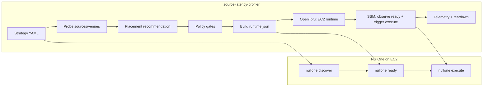

# Source Latency Profiler + NullOne: System Overview

## The problem it tries to solve

Latency-sensitive event-driven trading (NullOne's WNGSR → Kalshi gas storage use case) depends on:

- **Information sources** — EIA WNGSR JSON/CSV at release time
- **Execution venues** — Kalshi REST + WebSocket
- **Where you run** — AWS region, instance type, network path

"Pick the best region" is not obvious behind CDNs, Anycast, and load balancers. This repo answers:

> From candidate deployment locations, where should we run NullOne for the lowest latency, jitter, and failure rate on the sources and venues that matter — and can we **automate** provisioning, warmup, execution handoff, and teardown for a scheduled release?

The PRD is explicit: this is **infrastructure, measurement, and orchestration** — not trading logic. It does **not** place orders itself.

---

## Two layers: orchestrator vs NullOne



| Responsibility | `source-latency-profiler` | NullOne |
|----------------|---------------------------|---------|
| Latency probes | Yes | No |
| Region/instance selection | Yes | Consumes placement in `runtime.json` |
| Kalshi bracket discovery | Invokes `nullone discover`; imports spec | Owns discover logic + Kalshi API |
| Trading / sizing / orders | No | Yes (`execute`) |
| EC2 / Docker / secrets bootstrap | Yes (user-data + OpenTofu) | Runs inside container on host |
| Scheduler for release windows | Yes | Follows timing in `runtime.json` |

---

## What `source-latency-profiler` does end-to-end

### v1: Latency profiler

- Declares targets in YAML (HTTP + WebSocket).
- Probes DNS, TCP, TLS, TTFB, total time, errors.
- Writes JSONL results to local disk or S3.
- Ranks locations and produces placement recommendations.

### v2: Strategy deployment orchestrator

A **strategy profile** (e.g. `strategies/nullone-wngsr-kalshi.yaml`) bundles:

- **Event** — EIA WNGSR `week_ending`, release time
- **Markets** — Kalshi brackets via `nullone_discover` or pinned fixtures
- **Execution params** — edge, capital cap, `mode: paper`
- **Targets** — EIA + Kalshi endpoints to probe
- **Candidate locations** — AWS regions/instance types
- **Automation** — warmup at `T-30m`, profiler blackout at `T-2m`, execute at `T+0`
- **Deployment** — NullOne container image, `ready` / `execute` commands, Secrets Manager names

`strategy execute --apply` runs a fixed pipeline:

1. **Load strategy** and **resolve markets** — mandatory `nullone discover` for production YAML; imports brackets into the profile.
2. **Profile** — probe all source/venue targets from candidate runners; upload results to S3.
3. **Recommend + policy** — weighted scoring; gates on sample count, confidence, score margin, deploy cutoff.
4. **Live guardrails** — if mode were `live`, checks capital cap, immutable image, kill switch, etc.
5. **Build `runtime.json`** — single config NullOne reads on the runtime host (event, markets, execution, timing, placement).
6. **Provision** — OpenTofu applies ephemeral EC2; user-data pulls config from S3, materializes secrets, pulls ECR image, starts Docker.
7. **Warmup** — EC2 boots `nullone-ready.service` → `nullone ready --config /etc/nullone/runtime.json`. Orchestrator polls SSM until ready + health pass.
8. **Execution handoff** — if teardown is `after-execution` or diagnostics are on, orchestrator sends SSM command to run NullOne execute (see below).
9. **Telemetry** — orchestration events, optional diagnostics zip, `reconciliation-report.json` with `order_observed` from NullOne stdout.
10. **Teardown** — destroy ephemeral EC2; keep S3 telemetry.

The orchestrator **starts and observes** NullOne; it never submits Kalshi orders.

### Host scheduler

A separate systemd timer can run `profiler.cli scheduler run` to:

- Run `nullone discover` at market refresh offsets (`T-7d` … `T-30m`).
- Run full `strategy execute --apply` at `warmup_starts_at` (`T-30m`).

Offsets are relative to `event_time` in the strategy file; state tracks completed offsets so each fires once per event.

See `docs/production_runbooks.md` for operational commands.

For latency risks, edge cases, and implementation status of optimizations (host networking, kernel tuning, trace gaps), see [engineering-review.md](./engineering-review.md). For execute trigger timing (`ssm-immediate`, `ssm-lead`, `host-timer`), see [execution-handoff.md](./execution-handoff.md).

---

## NullOne execution logic (as this repo integrates it)

NullOne lives in a **separate repository**. This repo treats it as a black-box engine invoked by CLI and configured via `runtime.json`. From integration points and trace parsing, the execution model looks like this.

### 1. Market discovery (`nullone discover`)

Before each execute (and on scheduler refresh ticks):

```bash
nullone discover --week <week_ending> --output specs/eia_wngsr_<week_ending>.yaml
```

- Uses Kalshi credentials from Secrets Manager (via orchestrator env).
- Writes a NullOne spec with brackets, labels, and `kalshi.market_ticker` per strike.
- Profiler imports that spec into `strategy.markets` for the run.

Production YAML does not hardcode brackets; discovery is authoritative.

### 2. Runtime configuration (`/etc/nullone/runtime.json`)

Built by `build_nullone_runtime_config()` and uploaded to S3. NullOne receives:

- **Strategy** — name, `event_id`, `release_at_et`, `mode` (paper/live)
- **Event** — `week_ending`, metric, region
- **Markets** — resolved brackets + Kalshi event ticker
- **Execution** — `min_edge_after_fees`, `max_entry_price`, `release_capital_usd`, `execution_strategy`
- **Runtime timing** — absolute ISO timestamps for warmup, profiler blackout, execute
- **Sources / venues** — URLs and timeouts for EIA and Kalshi
- **Placement** — chosen AWS region/instance from orchestrator recommendation

NullOne uses this as the single source of truth for the hot path.

### 3. Warmup (`nullone ready`)

On EC2 boot, `nullone-ready.service` runs:

```text
nullone ready --config /etc/nullone/runtime.json
```

(via Docker exec when `artifact.type: container`.)

Warmup is meant to:

- Load config and strategy state
- Open allowed connections (Kalshi WS, etc.)
- Complete readiness before the release window

Orchestrator confirms via SSM: `nullone-ready.service` active, bootstrap logs, `nullone health`.

### 4. Production execute (`nullone execute`)

After readiness, orchestrator triggers (via SSM):

```text
/usr/local/bin/nullone-execute
→ nullone execute --config /etc/nullone/runtime.json
```

With `mode: paper` in runtime config, NullOne runs the real pipeline but submits **paper** orders (no live capital), per NullOne's own mode handling.

From `profiler/latency.py`, the hot path emits JSONL trace events in this order:

| Phase | Trace events |
|-------|----------------|
| Startup | `process_start` → `config_load_done` → `pipeline_init_done` |
| Execute | `execute_start` |
| Source | `source_fetch_start` → `source_fetch_done` |
| Decision | `parse_*` → `map_*` → `vector_*` → `kelly_*` |
| Order | `order_submit_start` → `order_submit_done` |

**Hot path latency** is measured from `execute_start` to `order_submit_done` — fetch EIA at release, parse/map/size, submit to Kalshi.

Timing in `runtime.json` (`execute_at`, `profiler_blackout_at`) tells NullOne when to enter blackout and when to own the hot path; the orchestrator is intentionally **off** that path after warmup.

### 5. Diagnostic execute paths (orchestrator-triggered)

When `--diagnostics` is set, orchestrator overrides the normal wrapper:

| Mode | Command | Purpose |
|------|---------|---------|
| `hot-path` | `nullone execute ... --diagnostic --simulate packaged --trace-jsonl` | Bounded fixture simulation; latency artifacts without live release |
| `live-paper` | `nullone execute ... --paper-live-release --trace-jsonl` | Real release window, live source fetch, forced paper orders |
| `none` (prod default) | `/usr/local/bin/nullone-execute` | Normal production path |

Diagnostics capture stdout/stderr, extract JSONL trace, build `latency-summary.json`, zip and upload to S3.

### 6. Reconciliation

After execute, orchestrator writes `reconciliation-report.json`:

- Exit code, SSM command id
- `order_observed` — last JSON object parsed from NullOne stdout (order/fill signal if logged)

That is the main in-repo proof that NullOne reached the order step.

### 7. Shutdown

`nullone shutdown` + container stop; orchestrator/terraform teardown removes the EC2 instance.

---

## Current WNGSR strategy shape (example)

`strategies/nullone-wngsr-kalshi.yaml` wires the above for one event:

- **Sources**: `ir.eia.gov/ngs/wngsr.json` and `.csv`
- **Venues**: Kalshi status HTTP + trade WebSocket
- **Markets**: `KXGASSTORAGE` series via `nullone discover`
- **Mode**: paper, $100 release capital
- **Automation**: profile at warmup, deploy by `T-3m`, execute at release
- **Runtime**: immutable NullOne image from ECR, secrets from `nullone/prod/*`

---

## Design principles

1. **Separation of concerns** — Profiler picks *where* and *when* to run; NullOne decides *what* to trade and *how*.
2. **Ephemeral runtime** — EC2 is disposable; durable audit lives in S3 + local `.generated/<run_id>/`.
3. **Profiler blackout** — Measurement and heavy orchestration stop before the hot window so they do not compete with execute.
4. **Policy-gated deploy** — Auto-deploy only when confidence, samples, margin, and cutoff checks pass (or fallback region is used).
5. **No secrets in Terraform state** — ARNs to Secrets Manager; PEM and `.env` fetched only on the runtime host.

---

## What this repo does not attempt

- Exchange trading logic, Kelly sizing, bracket mapping (NullOne)
- Guaranteed sub-ms latency on public cloud
- Continuous monitoring service (scheduled probes/orchestration are the model)
- Order placement from the orchestrator process itself

---

## Summary

**source-latency-profiler** is the control plane that measures network paths, chooses infrastructure, provisions a NullOne runtime, and hands off execution at the right time.

**NullOne** is the data plane that discovers markets, waits for EIA, runs the trading pipeline, and submits paper or live orders on Kalshi.
